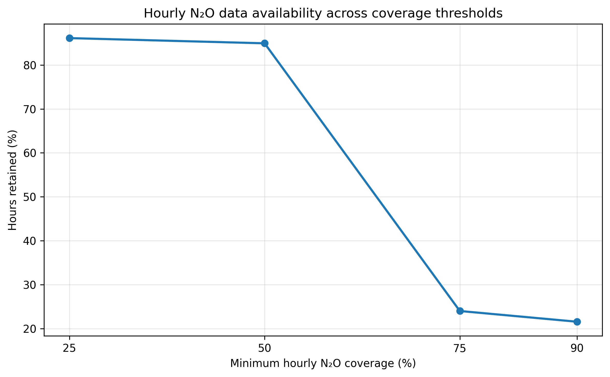
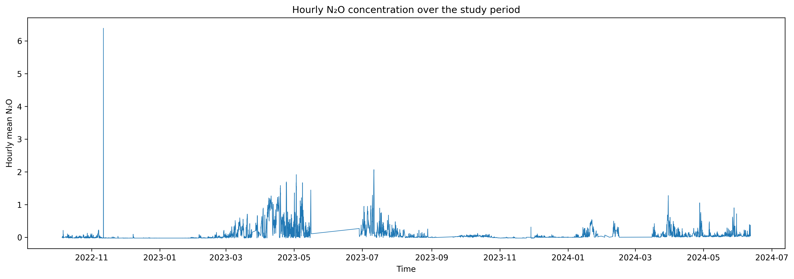
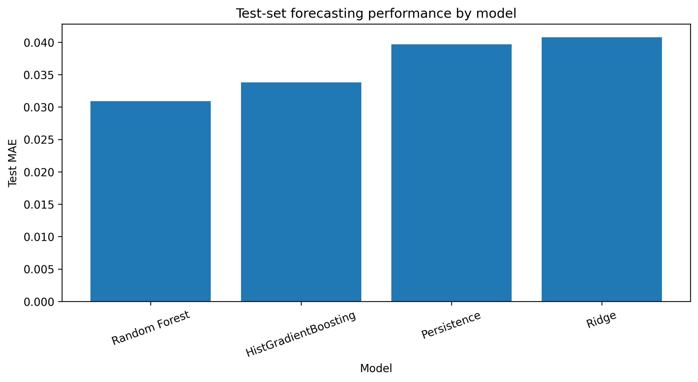
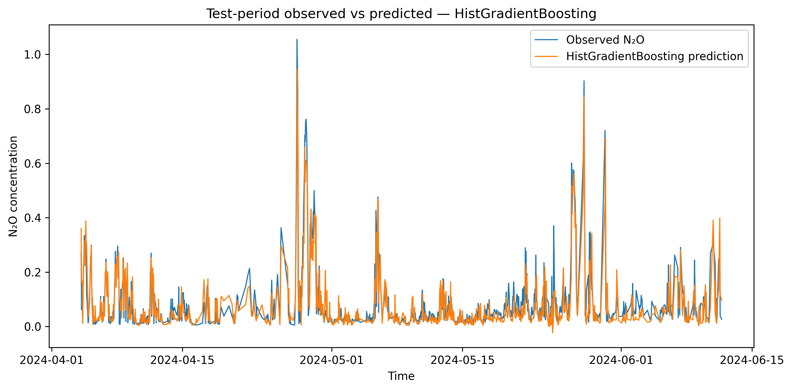
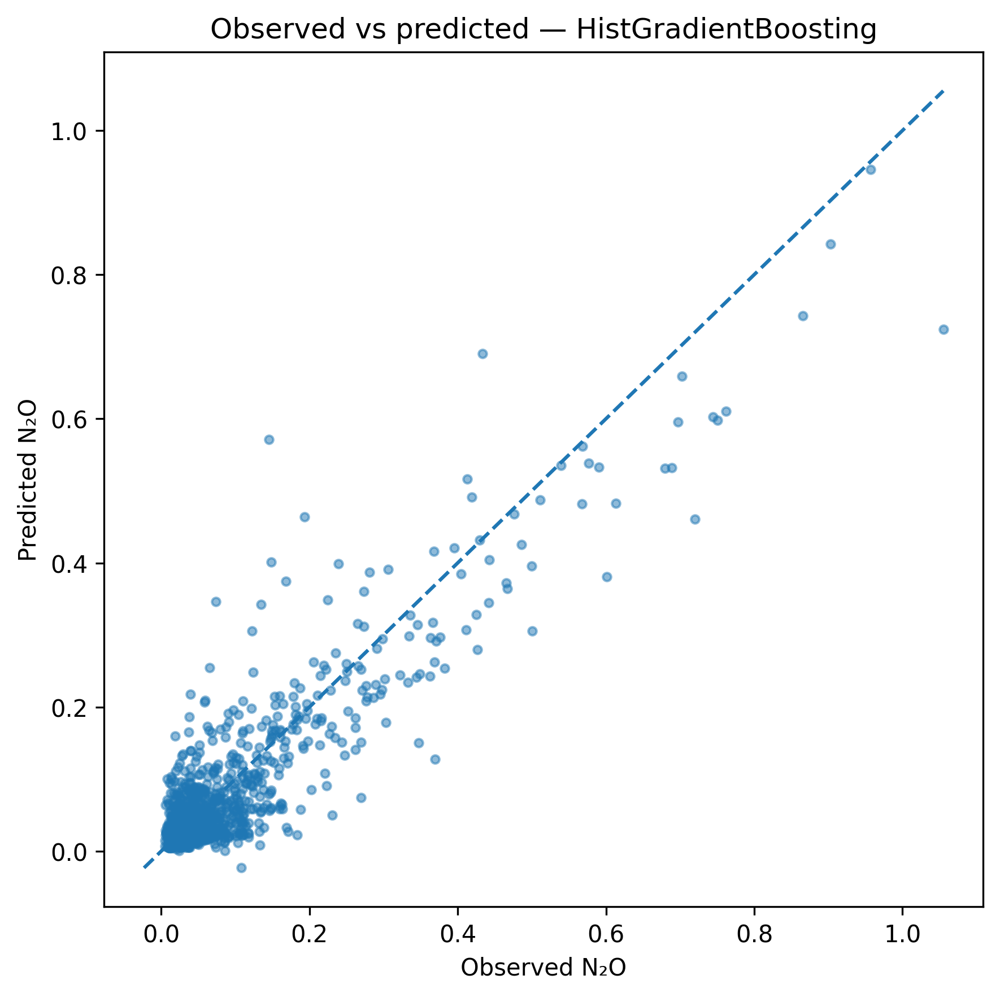
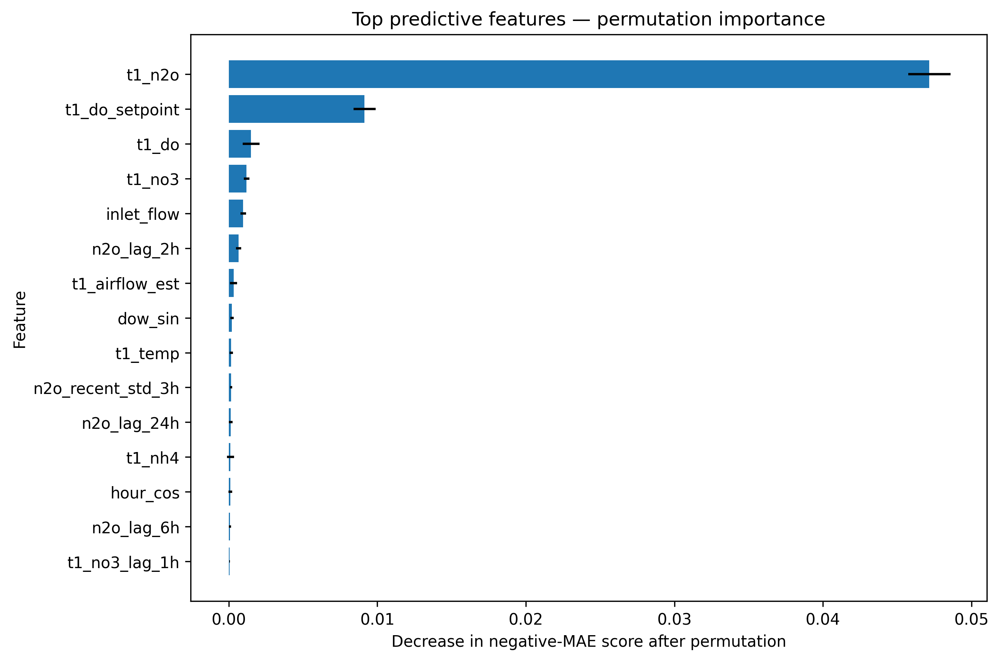
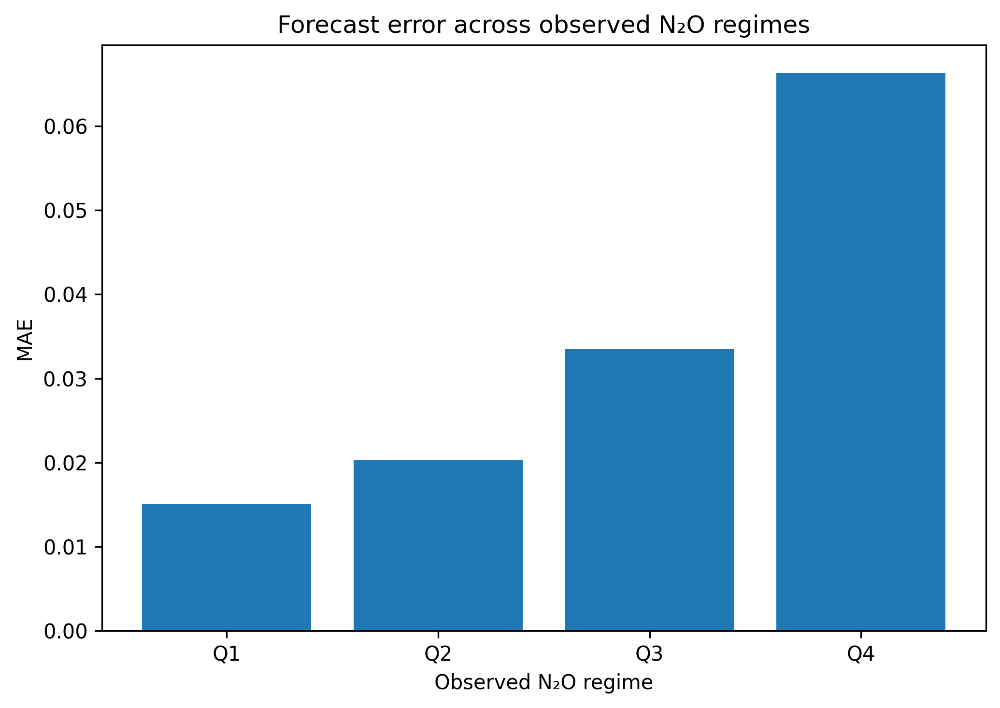

# Explainable Short-Horizon N₂O Forecasting for Wastewater Treatment Process Monitoring

An end-to-end data science project for forecasting **nitrous oxide (N₂O) concentration one hour ahead** in a full-scale wastewater treatment plant using quality-aware operational time-series data.

The project combines **SQL-based data preparation, statistical analysis, time-series feature engineering, chronological model evaluation, interpretable machine learning, and monitoring-oriented decision support**.

---

## Project Question

> **Can currently available wastewater-process measurements be used to forecast N₂O concentration one hour ahead, and which process variables contribute most to the forecast?**

### Operational scenario

At time **t**, current N₂O and wastewater-process/control measurements are assumed to be available. The model forecasts the **hourly mean N₂O concentration at t+1 hour**.

Current N₂O is therefore included as a predictor because it is available at forecast time. This is a short-horizon forecasting problem, not a scenario in which N₂O must be predicted without measuring N₂O.

---

## Key Results

| Item | Result |
|---|---:|
| Forecast horizon | 1 hour ahead |
| Modelling population | 7,510 hourly observations |
| Features | 38 |
| Selected model | HistGradientBoosting |
| Test MAE | **0.03382** |
| Test RMSE | **0.05301** |
| Test R² | **0.79879** |

The selected model was determined using the **validation period**, not the test period. HistGradientBoosting achieved the lowest validation MAE (0.03154), narrowly ahead of the persistence baseline (0.03168).

On the final test period, Random Forest achieved the lowest MAE among the compared models, but it was not selected because the test set was reserved for final temporal generalization assessment.

---

## Dataset

The project uses the **Avedøre Wastewater Treatment Plant (WWTP)** operational dataset from Denmark.

The dataset paper describes approximately two years of high-frequency operational data collected from a full-scale activated-sludge wastewater treatment process. The data include chemical measurements, process/control signals, temperature, suspended solids, and air/wastewater flow measurements.

The project audit of the uploaded CSV found:

- **906,815 rows**
- **49 columns**
- 1 timestamp column
- 24 value columns
- 24 corresponding quality columns
- Data spanning approximately June 2022 to June 2024
- Substantial missingness across operational signals
- N₂O raw missingness of approximately **42.6%**
- N₂O quality flags distinguishing good and bad observations

Each signal has a quality indicator:

- `0` = good quality
- `1` = bad quality

The raw measurement is not altered by its quality flag. Therefore, quality-aware preprocessing is required before modelling.

### Dataset source

Hansen et al., *Time Series Dataset for Modeling and Forecasting of N₂O in Wastewater Treatment*.

Data repository:  
https://data.mendeley.com/datasets/xmbxhscgpr/1

---

## Why the Problem Matters

N₂O is a greenhouse gas associated with biological wastewater treatment processes. Monitoring its concentration can provide information about process behaviour and potential emission-related conditions.

The project therefore focuses not only on prediction accuracy but also on answering:

- What process conditions are associated with the forecast?
- How reliable is the forecast under different N₂O regimes?
- Can the output support earlier monitoring of elevated N₂O conditions?
- What limitations should prevent the model from being treated as an autonomous controller?

---

## Project Workflow

```text
Raw wastewater time series
        ↓
DuckDB / SQL ingestion
        ↓
Quality-aware filtering
        ↓
Hourly aggregation
        ↓
Data coverage assessment
        ↓
Statistical analysis & EDA
        ↓
Feature engineering
        ↓
One-hour-ahead target construction
        ↓
Leakage checks
        ↓
Chronological train / validation / test split
        ↓
Persistence baseline
        ↓
Ridge Regression
        ↓
Random Forest
        ↓
HistGradientBoosting
        ↓
Model comparison & error analysis
        ↓
Permutation importance
        ↓
Monitoring-oriented decision support
```

---

## Data Preparation and SQL

DuckDB was used as the analytical SQL layer.

SQL was used as a substantive part of the workflow for:

- reading and querying the operational data
- selecting measurement and quality fields
- quality-aware filtering
- timestamp handling
- temporal aggregation
- conditional aggregation
- CTE-based transformations
- window-function diagnostics
- observation-count and coverage analysis

The final modelling table was then consumed by Python for statistical analysis and machine learning.

---

## Hourly Aggregation and Coverage

The raw operational data contain irregular high-frequency observations and substantial missingness. The project therefore aggregates the relevant signals to an hourly level before forecasting.

Multiple minimum hourly N₂O coverage thresholds were evaluated:

| Minimum hourly N₂O coverage | Hours retained |
|---:|---:|
| 25% | 86.12% |
| 50% | 84.94% |
| 75% | 24.00% |
| 90% | 21.56% |

A **50% minimum hourly coverage threshold** was used as the working criterion because increasing the requirement from 50% to 75% caused a large reduction in usable hours.

No long-gap interpolation of N₂O was used.



---

## Exploratory and Statistical Analysis

The analysis examined:

- N₂O distribution and skewness
- temporal behaviour
- hourly and weekly patterns
- monthly behaviour
- short-term persistence
- process-variable relationships
- phase representation
- quality and temporal coverage
- error behaviour across N₂O regimes

The dataset is not treated as an independent, identically distributed regression problem. Temporal dependence, nonstationarity, missingness, and intermittent elevated N₂O events are important characteristics of the data.

### N₂O temporal behaviour



The one-hour persistence analysis showed strong short-term dependence between current and next-hour N₂O, supporting the use of persistence as a required baseline.

---

## Forecasting Setup

### Target

The target is:

```text
N₂O(t + 1 hour)
```

constructed from the chronologically ordered hourly N₂O series.

### Predictors

The modelling table combines:

- current N₂O
- recent N₂O lag features
- dissolved oxygen
- DO setpoint
- nitrate
- ammonium
- airflow
- influent flow
- suspended solids
- temperature
- process/time features

All predictive information is restricted to information available at or before the forecast time.

### Leakage prevention

The project explicitly checks that:

- the target is shifted exactly one hour forward
- future observations are not used as predictors
- lag/rolling features are backward-looking
- chronological ordering is preserved
- the test period is not used for model selection

---

## Model Development

Four forecasting approaches were compared with a persistence baseline.

### Models

1. **Persistence**
   - Required baseline
   - Forecasts the next hour using the current N₂O level

2. **Ridge Regression**
   - Linear regularized baseline

3. **Random Forest**
   - Nonlinear tree ensemble

4. **HistGradientBoosting**
   - Gradient-boosted tree model for tabular process data

No large model zoo was used. The project deliberately prioritizes disciplined model comparison over unnecessary model complexity.

### Temporal split

The data were divided chronologically into:

- training period
- validation period
- final test period

No random train/test split was used.

---

## Model Comparison

| Model | Validation MAE | Test MAE | Test RMSE | Test R² |
|---|---:|---:|---:|---:|
| HistGradientBoosting | 0.03154 | 0.03382 | 0.05301 | 0.79879 |
| Persistence | 0.03168 | 0.03968 | 0.06857 | 0.66333 |
| Random Forest | 0.03237 | **0.03088** | **0.05131** | **0.81149** |
| Ridge | 0.04228 | 0.04077 | 0.06449 | 0.70222 |



### Model-selection interpretation

HistGradientBoosting was selected using validation MAE because the test set was reserved for final evaluation.

The validation advantage over persistence was small:

```text
HistGradientBoosting validation MAE: 0.03154
Persistence validation MAE:          0.03168
```

This is important: the forecasting problem has strong short-term persistence, so the machine-learning model should be judged against that baseline rather than presented as a dramatic improvement.

---

## Final Forecast Performance



The temporal comparison shows that the model follows the major changes in N₂O concentration, including several elevated periods, while smoothing some of the highest peaks.

The observed-vs-predicted scatter plot is retained as an additional supporting diagnostic:



---

## Model Interpretability

Permutation importance was used as the primary explainability method.

The strongest predictive variables were:

1. Current N₂O (`t1_n2o`)
2. DO setpoint (`t1_do_setpoint`)
3. Dissolved oxygen (`t1_do`)
4. Nitrate (`t1_no3`)
5. Influent flow (`inlet_flow`)
6. Recent N₂O lag features
7. Airflow estimate



Current N₂O dominates the permutation-importance results, which is consistent with the strong short-term persistence observed in the data.

The importance results should be interpreted as **predictive associations**, not causal effects. Correlated process variables can also share predictive information.

---

## Error Analysis

Forecast error increases substantially as observed N₂O moves into higher regimes.

| Observed regime | MAE | RMSE |
|---|---:|---:|
| Q1 | 0.01508 | 0.02534 |
| Q2 | 0.02036 | 0.02998 |
| Q3 | 0.03350 | 0.04393 |
| Q4 | 0.06634 | 0.08811 |



The model tends to underpredict elevated N₂O concentrations. This is an important operational limitation: average forecasting performance alone does not fully describe performance during the highest-concentration events.

---

## Monitoring-Oriented Decision Support

The final layer translates the forecast into a simple monitoring workflow:

```text
Current process state
        ↓
Predicted N₂O at t+1 hour
        ↓
Elevated-monitoring flag
        ↓
Important predictive drivers
        ↓
Wastewater-process interpretation
```

An analytical upper-percentile threshold was used to demonstrate the monitoring concept. It is **not a regulatory or compliance threshold**.

The purpose is to demonstrate how a forecasting model could support earlier process monitoring rather than automatically control the treatment plant.

---

## Key Findings

### 1. N₂O is strongly persistent at the one-hour horizon

The strong relationship between current and next-hour N₂O means that recent N₂O history provides most of the short-horizon predictive information.

### 2. Process variables add information beyond simple persistence

DO setpoint, DO, nitrate, influent flow, airflow and other process variables provide additional predictive information.

### 3. Elevated N₂O is harder to forecast

Error increases markedly in the upper N₂O regime, with systematic underprediction of some elevated events.

### 4. Data quality is a major part of the problem

The raw dataset contains substantial missingness and quality-flagged observations. Quality-aware aggregation is therefore essential.

### 5. The model is better viewed as an early-monitoring tool

The results support a forecasting and monitoring workflow rather than autonomous process control.

---

## Limitations

- The dataset represents one full-scale wastewater treatment plant and primarily one biological line/carousel context; results should not automatically be generalized to other plants.
- N₂O measurements contain substantial missingness and quality-flagged periods.
- The short-horizon forecast benefits strongly from current N₂O persistence.
- Forecast performance deteriorates during high-N₂O regimes.
- Permutation importance describes predictive contribution, not causation.
- Process variables can be correlated, making individual importance values difficult to interpret as independent effects.
- Phase-based statistical comparisons are observational and should not be interpreted causally.
- The analytical monitoring threshold is dataset-derived and is not a regulatory limit.
- The model has not been validated prospectively in a live plant-control environment.

---

## Repository Structure

```text
N2O-Wastewater-Forecasting/
│
├── README.md
│
├── notebooks/
│   └── N2O_Forecasting_End_to_End.ipynb
│
├── sql/
│   └── wastewater_analysis.sql
│
├── figures/
│   ├── n2o_coverage.png
│   ├── n2o_time_series.png
│   ├── model_comparison.png
│   ├── observed_vs_predicted.png
│   ├── observed_vs_predicted_scatter.png
│   ├── feature_importance.png
│   └── error_by_regime.png
│
├── requirements.txt
│
└── .gitignore
```

The raw wastewater CSV is not included in the repository. Users should obtain the dataset from the original data source and place it in the expected local data location before reproducing the analysis.

---

## Reproducibility

### Environment

The project uses Python-based data analysis and machine learning together with DuckDB for analytical SQL.

Core libraries include:

```text
pandas
numpy
matplotlib
scikit-learn
duckdb
```

### Reproduction workflow

1. Obtain the Avedøre WWTP dataset from the original repository.
2. Place the raw data in the project data location.
3. Run the SQL/data-preparation workflow.
4. Execute the end-to-end notebook in chronological order.
5. Verify the data-quality and target-construction checks.
6. Reproduce the chronological train/validation/test split.
7. Train and evaluate the candidate models.
8. Generate the interpretability and error-analysis outputs.

---

## Conclusion

This project demonstrates an end-to-end approach to a real environmental process-data problem:

> **quality-aware wastewater data → SQL-based preparation → statistical analysis → one-hour-ahead forecasting → temporal validation → interpretable prediction → monitoring-oriented decision support.**

The main result is that short-horizon N₂O forecasting is feasible using currently available process measurements, but the problem is strongly influenced by recent N₂O history and becomes substantially more difficult during elevated N₂O events.

The resulting system is therefore best positioned as an **explainable early-monitoring tool**, not an autonomous wastewater process controller.

---

## Data and Research Source

Hansen, L. D., Stentoft, P. A., Ortiz-Arroyo, D., & Durdevic, P.  
*Time Series Dataset for Modeling and Forecasting of N₂O in Wastewater Treatment.*

Dataset: https://data.mendeley.com/datasets/xmbxhscgpr/1
